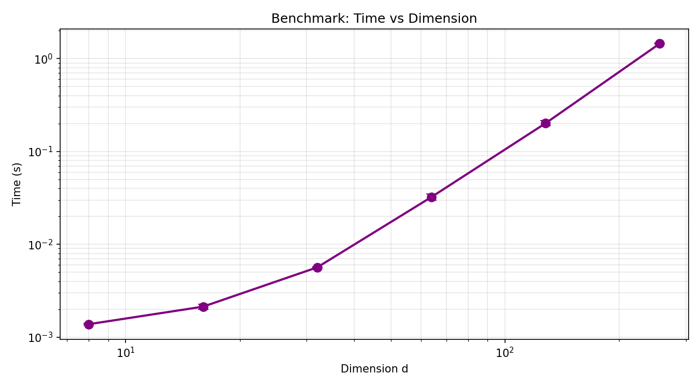
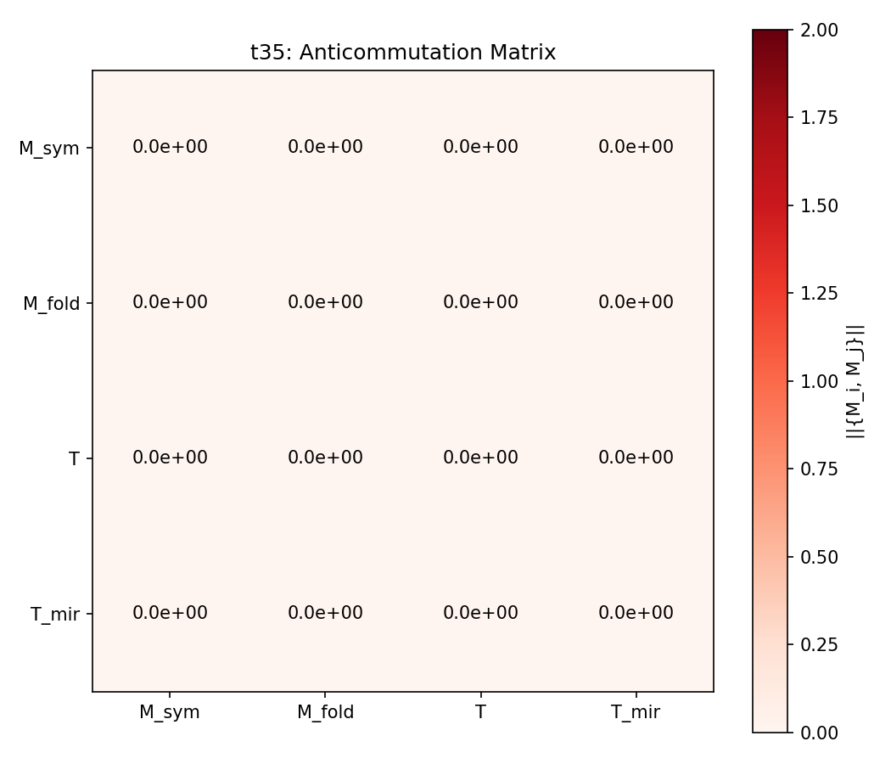
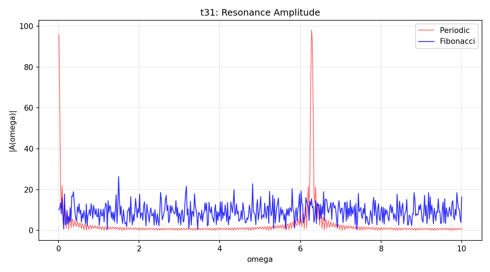
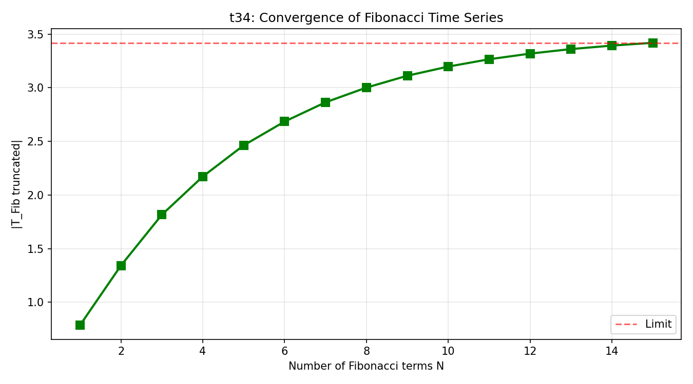
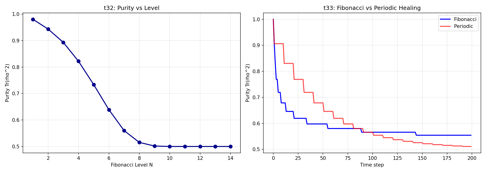

# ShrPP_FT_PIC

**SHRPPCore: PIC Infinite-Domain Open Quantum System Framework**

[](LICENSE)
[](https://www.python.org)
[](https://numpy.org)

พัฒนาและจัดทำโดย **Chutiphong Bunloed**  
Independent Researcher, Buriram, Thailand  
ORCID: [0009-0003-4295-7521](https://orcid.org/0009-0003-4295-7521)  
DOI: [10.5281/Zenodo.23384785](https://doi.org/10.5281/Zenodo.23384785)

---

## ภาพรวม

**ShrPP_FT_PIC** เป็นชุดโค้ด Python สำหรับทดลองและจำลองคอนเซปต์ระบบควอนตัมเปิดด้วยเครื่องมือเชิงตัวเลขของ NumPy โดยมีองค์ประกอบหลักดังนี้

- ลำดับเวลาแบบ Fibonacci และขนาดของแอมพลิจูดแบบลดลงด้วยอัตราส่วน golden ratio
- Lindblad-style evolution สำหรับ density matrix
- Operators สำหรับ unified mirror, component mirrors และ generalized mirror
- โค้ดทดสอบเชิงสเปกตรัม, purity, dynamic decoupling และสมบัติพีชคณิต
- Benchmark การคำนวณ Lindblad step ตามขนาดมิติ

จุดสำคัญคือมิติของ density matrix และมาตรฐานการจำลองของระบบควบคุมไม่ได้ฝังอยู่ในโครงสร้างหลักจนทำให้โค้ดเป็นแพ็คเกจแบบปรับแต่งได้อย่างสมบูรณ์ ตัวอย่างจึงใช้ APIs ที่มีอยู่ในไฟล์นี้โดยตรง

> โค้ดปัจจุบันเป็นโค้ดวิจัยและเปรียบเทียบเชิงตัวเลข โดยโค้ดของ Lindblad evolution สามารถรันได้บน NumPy หากต้องนำไปใช้งานเชิงอุปกรณ์หรือระบบจริง ต้องประเมินและขยายโมเดล Hamiltonian, noise operators และเงื่อนไขฟิสิกส์เพิ่มเติม

## คุณสมบัติที่มีในโค้ด

| คุณสมบัติ | API/ไฟล์หลัก |
|---|---|
| ลำดับ Fibonacci | `SHRPPCore.fibonacci_sequence()` |
| เวลา Fibonacci | `SHRPPCore.fibonacci_time()` |
| แอมพลิจูด/เฟส Fibonacci | `SHRPPCore.fibonacci_amplitudes()`, `SHRPPCore.fibonacci_phases()` |
| Lindblad evolution | `SHRPPCore.lindblad_step()`, `SHRPPCore.lindblad_evolve()` |
| Density-matrix purity | `SHRPPCore.purity()` |
| Unified/component mirror | `SHRPPCore.unified_mirror()`, `SHRPPCore.mirror_components()` |
| Generalized mirror | `SHRPPCore.generalized_mirror(level)` |
| สเปกตรัมแอมพลิจูด | `resonance_amplitude()`, `resonance_spectrum()`, `fib_spectral_function()` |

## โครงสร้าง Repository

```text
ShrPP_FT_PIC/
├── shrpp_core.py          # คลาสหลัก ฟังก์ชันสเปกตรัม และ mirror operators
├── test_shrpp.py          # การทดสอบเชิงตัวเลข t31-t35 และ t40
├── benchmark_shrpp.py     # Benchmark ขนาดมิติ 8 ถึง 256
├── pp01.png ... pp05.png  # กราฟผลลัพธ์สำหรับ README/documentation
├── CITATION.cff           # Metadata สำหรับการอ้างอิง
├── LICENSE                # GNU AGPL-3.0
├── README.md              # เอกสารโปรเจกต์
└── index.md               # เนื้อหาเว็บไซต์ประกอบเอกสาร
```

## การติดตั้ง

ต้องใช้ Python 3 และ NumPy

```bash
git clone https://github.com/synthesis496/ShrPP_FT_PIC.git
cd ShrPP_FT_PIC
pip install numpy
```

ไม่มีไฟล์ติดตั้งแพ็กเกจหรือ build step เพิ่มเติมใน repository นี้

## Quick Start

### เริ่มต้นด้วย SHRPPCore

```python
from shrpp_core import SHRPPCore

core = SHRPPCore(dimension=16)

fib_times = core.fibonacci_time(n_max=100)
fib_amplitudes = core.fibonacci_amplitudes(n_max=100)

rho = core.rho_error.copy()
healed_rho = core.lindblad_evolve(rho, steps=500, dt=0.001)
print("Purity:", core.purity(healed_rho))
print("Trace:", healed_rho.trace())
```

ในตัวสร้าง `SHRPPCore(dimension, alpha=0.5, gamma=1.0, k0=1.0)` ค่าเริ่มต้นคือ:

- `dimension`: จำนวนมิติของ density matrix
- `alpha`: ตัวชี้กำลังสำหรับแอมพลิจูด Fibonacci
- `gamma`: ค่า coupling สำหรับ healing operator
- `k0`: สเกลสำหรับ generalized mirror

### คำนวณสเปกตรัม

```python
import numpy as np
from shrpp_core import SHRPPCore, resonance_spectrum

core = SHRPPCore(dimension=5)
times = core.fibonacci_time(n_max=100)
omegas = np.linspace(0.01, 10.0, 2000)

amplitude = resonance_spectrum(times, omegas)
print("Maximum amplitude:", amplitude.max())
```

### ใช้ mirror operators

```python
from shrpp_core import SHRPPCore

core = SHRPPCore(dimension=16)
unified = core.unified_mirror()
components = core.mirror_components()

# generalized mirror เป็น diagonal matrix
mirror, k = core.generalized_mirror(level=5)
print("k:", k)
```

`unified_mirror()` และ `mirror_components()` สร้าง operator จากโครงสร้าง tensor-product ของ Pauli matrices และได้รับการทดสอบร่วมกับมิติ 16 ใน repository

## Running Tests

ไฟล์ทดสอบจะเขียนผลลัพธ์ลง `shrpp_results.json`

```bash
python test_shrpp.py
```

ผลหลักที่ทดสอบ:

- **t31** เปรียบเทียบ resonance ของ Fibonacci time กับ periodic time
- **t32** ตรวจ purity ระยะยาวและตรวจ monotonicity ตามขีด tolerance
- **t33** เปรียบเทียบ Fibonacci gate positions กับ periodic gate positions
- **t34** คำนวณ partial sums ของ Fibonacci-weighted spectral series
- **t35** ตรวจ involution error และ anti-commutation norms ของ mirror components
- **t40** ทดสอบการฉาย codespace และ error state ด้วย generalized mirror

ตัวอย่างผลลัพธ์จะอยู่ในรูปแบบ JSON เช่น:

```json
{
  "t31": {
    "max_periodic": 100.0,
    "max_fibonacci": 2.5,
    "suppression_ratio": 40.0
  }
}
```

ค่าโดยประมาณอาจแตกต่างตามเวอร์ชัน NumPy หรือแพลตฟอร์ม

## Benchmark

รัน benchmark สำหรับมิติ 8, 16, 32, 64, 128 และ 256 โดยวัดเวลา 5 รอบต่อมิติ เพื่อคำนวณ scaling exponent ด้วย log-log linear fit

```bash
python benchmark_shrpp.py
```

โปรแกรมจะเขียนผลไปที่ `shrpp_benchmark.json` โดยมีฟิลด์:

- `dimensions`
- `times`
- `std`
- `scaling_exponent`

## ผลการทดลองในรูปภาพ

### ความชันการสเกลและสมบัติการหักล้างของ mirror

<p align="center">
  
  
</p>

<p align="center">
  <em>ภาพซ้าย: benchmark เวลาเทียบกับมิติ และภาพขวา: ผลการตรวจ anticommutation/algebraic consistency</em>
</p>

### Resonance suppression และ numerical convergence

<p align="center">
  
  
</p>

<p align="center">
  <em>ภาพซ้าย: resonance spectrum และภาพขวา: ผล convergence ของ series</em>
</p>

### Purity healing และ dynamic decoupling

<p align="center">
  
</p>

<p align="center">
  <em>ภาพเปรียบเทียบ purity evolution และผลจาก Fibonacci/periodic gate positions</em>
</p>

## รายละเอียด Implementation

### Lindblad evolution

`lindblad_step(rho, dt)` คำนวณ

\[
\dot{\rho}=-i[H,\rho]+\gamma\left(L\rho L^\dagger-
\frac{1}{2}\{L^\dagger L,\rho\}\right)
\]

แล้วบวกผลกับ density matrix และ normalize ด้วย `trace(rho_new)` โดยในตัวตั้งต้น `H` เป็น zero matrix และ `L_heal` มี elements ที่เลื่อนไปสองตำแหน่ง

### Fibonacci sequence

ค่าเริ่มต้นคือ `[1, 1, ...]` โดยใช้ recurrence

\[
F_n=F_{n-1}+F_{n-2}
\]

แอมพลิจูดใช้

\[
A_n=\phi^{-\alpha n}
\]

และ phase ใช้ \( (-1)^n\theta_0 \) โดยตัวแปรเริ่มต้น `phi`, `alpha` และ `theta0` มาจาก `shrpp_core.py`

### Pure state และ purity

`rho_error` เริ่มต้นเป็น density matrix ที่มีค่า 1.0 ที่ `[0,0]` และ purity คำนวณจาก

\[
\mathrm{Purity}(\rho)=\mathrm{Re}\left(\operatorname{Tr}(\rho^2)\right)
\]

## License

โค้ดใน repository นี้เผยแพร่ภายใต้ [GNU Affero General Public License v3.0](LICENSE)

Copyright (c) 2026 Chutiphong Bunloed. All Rights Reserved.

## Citation

```bibtex
@software{bunloed2026shrpp,
  author       = {Bunloed, Chutiphong},
  title        = {ShrPP_FT_PIC: PIC Infinite-Domain Open Quantum System Framework using Fibonacci Time Self-Similarity and Folding Mirrors},
  year         = {2026},
  publisher    = {GitHub},
  version      = {1.0.0},
  url          = {https://github.com/synthesis496/ShrPP_FT_PIC},
  doi          = {10.5281/Zenodo.23384785}
}
```

สำหรับข้อมูลจาก GitHub สามารถอ่าน metadata ได้ที่ [`CITATION.cff`](CITATION.cff)

## Contact

- Email: [synthesis496@gmail.com](mailto:synthesis496@gmail.com)
- Repository: <https://github.com/synthesis496/ShrPP_FT_PIC>
