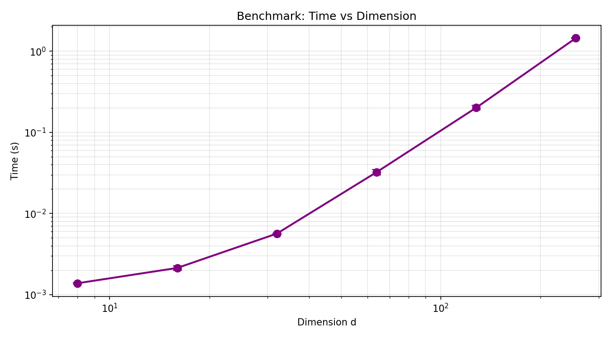
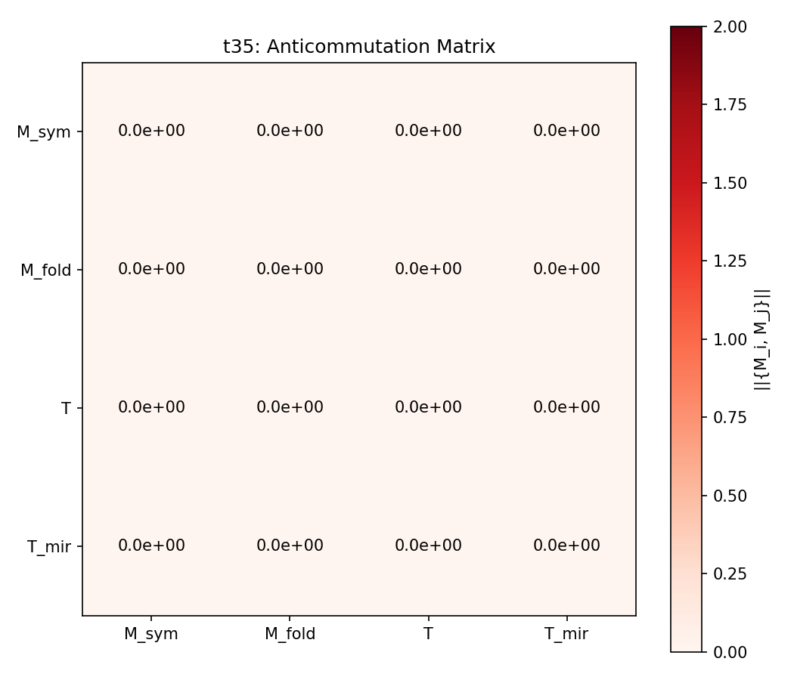
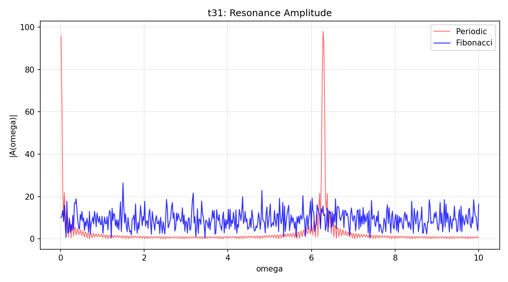
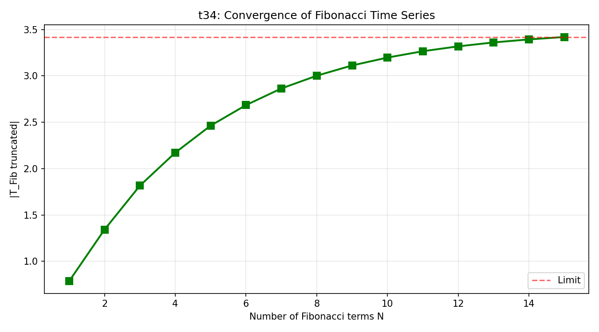
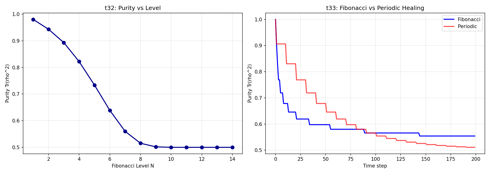

# ShrPP_FT_PIC

**SHRPPCore: PIC Infinite-Domain Open Quantum System Framework**

[](LICENSE)
[](https://www.python.org)
[](https://numpy.org)

Developed by **Chutiphong Bunloed**  
Independent Researcher, Buriram, Thailand  
ORCID: [0009-0003-4295-7521](https://orcid.org/0009-0003-4295-7521)  
DOI: [10.5281/Zenodo.23384785](https://doi.org/10.5281/Zenodo.23384785)

---

## Overview

**ShrPP_FT_PIC** is a NumPy-based Python research framework for studying open quantum-system dynamics, Fibonacci-time evolution, and dimensional mirror operators.

The repository currently provides:

- Fibonacci sequences and Fibonacci-time samples
- Fibonacci-weighted amplitudes and alternating phases
- Lindblad-style density-matrix evolution
- Unified, component, and generalized mirror operators
- Numerical tests for resonance suppression, purity, mirror algebra, and codespace behavior
- A runtime scaling benchmark across dimensions 8–256

> This repository is a numerical research implementation. Its current Hamiltonian is zero in `SHRPPCore`, while the Lindblad evolution uses a healing operator. Extending the implementation for hardware or physical deployment requires defining and validating the appropriate Hamiltonian, noise operators, and system constraints.

## Key Features

| Feature | Implementation |
|---|---|
| Fibonacci sequence | `SHRPPCore.fibonacci_sequence()` |
| Fibonacci time | `SHRPPCore.fibonacci_time()` |
| Fibonacci amplitudes | `SHRPPCore.fibonacci_amplitudes()` |
| Fibonacci phases | `SHRPPCore.fibonacci_phases()` |
| Lindblad evolution | `SHRPPCore.lindblad_step()`, `SHRPPCore.lindblad_evolve()` |
| Density-matrix purity | `SHRPPCore.purity()` |
| Unified/component mirrors | `SHRPPCore.unified_mirror()`, `SHRPPCore.mirror_components()` |
| Generalized mirror | `SHRPPCore.generalized_mirror(level)` |
| Resonance spectra | `resonance_amplitude()`, `resonance_spectrum()`, `fib_spectral_function()` |

## Repository Structure

```text
ShrPP_FT_PIC/
├── shrpp_core.py          # Core class, spectral functions, and mirror operators
├── test_shrpp.py          # Numerical tests t31-t35 and t40
├── benchmark_shrpp.py     # Runtime benchmark for dimensions 8 through 256
├── pp01.png ... pp05.png  # Generated result figures
├── CITATION.cff           # Citation metadata
├── LICENSE                # GNU AGPL-3.0 license
├── README.md              # Project documentation
└── index.md               # Documentation website content
```

## Installation

Python 3 and NumPy are required.

```bash
git clone https://github.com/synthesis496/ShrPP_FT_PIC.git
cd ShrPP_FT_PIC
pip install numpy
```

No additional package or build configuration is currently included in the repository.

## Quick Start

### Create a core instance

```python
from shrpp_core import SHRPPCore

core = SHRPPCore(dimension=16)

fib_times = core.fibonacci_time(n_max=100)
fib_amplitudes = core.fibonacci_amplitudes(n_max=100)

rho = core.rho_error.copy()
healed_rho = core.lindblad_evolve(rho, steps=500, dt=0.001)

print("Purity:", core.purity(healed_rho))
print("Trace:", healed_rho.trace())
```

`SHRPPCore(dimension, alpha=0.5, gamma=1.0, k0=1.0)` has these constructor parameters:

- `dimension`: size of the density matrix
- `alpha`: exponent for Fibonacci amplitudes
- `gamma`: healing-operator coupling
- `k0`: scale used by the generalized mirror

### Calculate a resonance spectrum

```python
import numpy as np
from shrpp_core import SHRPPCore, resonance_spectrum

core = SHRPPCore(dimension=5)
times = core.fibonacci_time(n_max=100)
omegas = np.linspace(0.01, 10.0, 2000)

amplitude = resonance_spectrum(times, omegas)
print("Maximum amplitude:", amplitude.max())
```

### Use mirror operators

```python
from shrpp_core import SHRPPCore

core = SHRPPCore(dimension=16)
unified = core.unified_mirror()
components = core.mirror_components()

mirror, k = core.generalized_mirror(level=5)
print("k:", k)
```

The mirror operators are constructed from tensor products of two-dimensional Pauli matrices. The 16-dimensional implementation is exercised by test `t35`.

## Running the Tests

The test script writes results to `shrpp_results.json`:

```bash
python test_shrpp.py
```

The tests cover:

- **t31**: Fibonacci-time versus periodic-time resonance suppression
- **t32**: purity evolution and monotonicity over cumulative Fibonacci levels
- **t33**: Fibonacci-position versus periodic-position dynamic decoupling
- **t34**: partial sums of the Fibonacci-weighted spectral series
- **t35**: involution and anti-commutation properties of mirror components
- **t40**: codespace and error-state behavior for a generalized mirror

Results are serialized as JSON. Numerical values may vary slightly depending on the NumPy version and platform.

## Running the Benchmark

The benchmark evaluates dimensions 8, 16, 32, 64, 128, and 256. It performs five measurements per dimension and estimates the scaling exponent using a log-log linear fit.

```bash
python benchmark_shrpp.py
```

This writes `shrpp_benchmark.json` containing:

- `dimensions`
- `times`
- `std`
- `scaling_exponent`

## Experimental Results

### Scaling and Mirror Algebra

<p align="center">
  
  
</p>

<p align="center">
  <em>Left: runtime versus dimension. Right: anti-commutation/algebraic consistency results.</em>
</p>

### Resonance Suppression and Numerical Convergence

<p align="center">
  
  
</p>

<p align="center">
  <em>Left: resonance spectrum. Right: spectral series convergence.</em>
</p>

### Purity Healing and Dynamic Decoupling

<p align="center">
  
</p>

<p align="center">
  <em>Comparison of purity evolution and Fibonacci versus periodic gate positions.</em>
</p>

## Implementation Details

### Lindblad evolution

`lindblad_step(rho, dt)` evaluates

\[
\dot{\rho}=-i[H,\rho]+\gamma\left(L\rho L^\dagger-
\frac{1}{2}\{L^\dagger L,\rho\}\right)
\]

It updates the density matrix and normalizes the result by `np.trace(rho_new)`. In the default configuration, `H` is a zero matrix and `L_heal` contains entries shifted by two indices.

### Fibonacci sequence

The sequence begins with `[1, 1, ...]` and uses:

\[
F_n=F_{n-1}+F_{n-2}
\]

Fibonacci amplitudes are calculated as:

\[
A_n=\phi^{-\alpha n}
\]

Alternating phases use \((-1)^n\theta_0\). Defaults are defined in `shrpp_core.py`.

### Purity

`rho_error` is initialized with a 1.0 entry at `[0, 0]`. Purity is calculated as:

\[
\mathrm{Purity}(\rho)=\mathrm{Re}\left(\operatorname{Tr}(\rho^2)\right)
\]

## License

This repository is distributed under the [GNU Affero General Public License v3.0](LICENSE).

Copyright (c) 2026 Chutiphong Bunloed. All Rights Reserved.

## Citation

```bibtex
@software{bunloed2026shrpp,
  author       = {Bunloed, Chutiphong},
  title        = {ShrPP_FT_PIC: PIC Infinite-Domain Open Quantum System Framework using Fibonacci Time Self-Similarity and Folding Mirrors},
  year         = {2026},
  publisher    = {GitHub},
  version      = {1.0.0},
  url          = {https://github.com/synthesis496/ShrPP_FT_PIC},
  doi          = {10.5281/Zenodo.23384785}
}
```

Machine-readable citation metadata is available in [`CITATION.cff`](CITATION.cff).

## Contact

- Email: [synthesis496@gmail.com](mailto:synthesis496@gmail.com)
- Repository: <https://github.com/synthesis496/ShrPP_FT_PIC>


